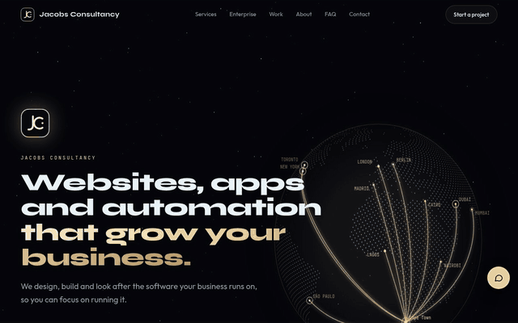

  

## Hi, I'm Cheslin

I wrote my first lines of code in a Grade 7 computer class and never quite stopped. After school I went to work for a few years, and the whole time I kept coming back to building things on a screen. Eventually I went back to studying and turned it into my job.

These days I run **[Jacobs Consultancy](https://thejacobsconsultancy.com)**, a small web studio in Cape Town. I build websites and custom web apps for small businesses, and I'm the person clients actually talk to from the first call to launch day and after.

### What I'm working on

- **Jacobs Consultancy.** Fast static websites on Cloudflare, local SEO so people nearby can find you, custom web apps like booking systems, client portals and quote tools, and monthly care plans that keep everything updated and running.
- **Junior Head of Tech at a US media company with over 1 million subscribers.** I work alongside their head of technology on the platform their audience uses every day. I built the subscription tier system and the Stripe and PayPal payment integrations, including the shop and store credits.
- **AWS.** I'm an AWS re/Start learner working toward the Cloud Practitioner certification. My labs and write-ups live in [AWS-Restart](https://github.com/CJacobsCreates/AWS-Restart).

### How I like to build

I keep things simple, fast and safe. Static pages where a page doesn't need a server, small serverless functions where it does, strict security headers, and no plugins that need patching every other week. If a site can load in under a second on a cheap phone, it should.

**Tools I reach for:** JavaScript, HTML and CSS, Cloudflare Pages and Workers, Stripe, PayPal, PHP and MySQL, Python, AWS, Git

### Featured work

[thejacobsconsultancy.com](https://thejacobsconsultancy.com): my studio's own site, static on Cloudflare Pages.

### Pinned work

- [jacobs-consultancy-site](https://github.com/CJacobsCreates/jacobs-consultancy-site): my studio's own site, with a spam-protected contact form and a rate-limited AI chat running on Cloudflare
- [low-water-smoke-co](https://github.com/CJacobsCreates/low-water-smoke-co): a fictional BBQ sauce brand I built as a full Shopify store demo
- [AWS-Restart](https://github.com/CJacobsCreates/AWS-Restart): hands-on AWS labs, architecture notes and a serverless restaurant project

<picture>
  <source media="(prefers-color-scheme: dark)" srcset="https://raw.githubusercontent.com/CJacobsCreates/CJacobsCreates/output/snake-dark.svg" />
  
</picture>

### Say hello

If you're hiring, or you run a business and your website isn't pulling its weight, I'd be glad to hear from you.

[thejacobsconsultancy.com](https://thejacobsconsultancy.com) · [info@thejacobsconsultancy.com](mailto:info@thejacobsconsultancy.com)
